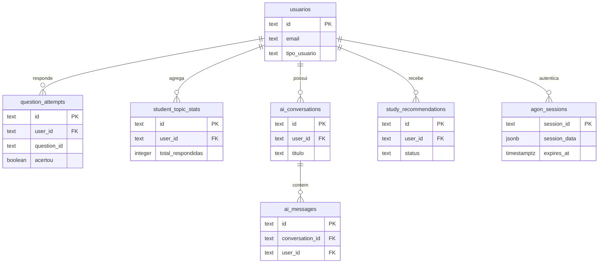

# Agon — Plataforma de Estudos com Supabase & Zuka IA

## Desenvolvimento desta versão

Use Node.js 20 (`.nvmrc`) e execute `npm ci`, copie `.env.example` para `.env` (se disponível) e configure as variáveis localmente. Rode `npm run build:css` e `npm run dev`. As operações administrativas de questões exigem uma conta com papel `professor` ou `admin`; crie/promova o primeiro administrador com `ADMIN_EMAIL`, `ADMIN_PASSWORD` (mínimo de 20 caracteres) e, opcionalmente, `ADMIN_NAME`, depois `npm run seed:admin`. Para importar JSON/CSV pelo terminal: `npm run import:questoes -- caminho/questoes.json` ou `.csv`. Os modelos ficam em `data/questoes/`.

As rotas `/api/questoes` não retornam gabarito na listagem; respostas são corrigidas pela RPC no banco. O importador administrativo manual aceita JSON/CSV e tem formulário, mas importação de PDF com revisão assistida por IA, geração de questões inéditas e aprovação editorial ainda não estão disponíveis.

| Área | Estado |
| --- | --- |
| Cadastro, login, dashboard, questões e Zuka | Integrados às APIs disponíveis (Zuka depende da chave Gemini). |
| Administração de questões | Formulário manual e importação JSON/CSV; sem PDF e sem fila de revisão por IA. |
| Desempenho | Integração existente; depende de tentativas reais no banco. |
| Aulas, estudos, simulados, comunidade, planos, materiais, conquistas e configurações | Protótipo conforme os avisos da interface. |

As verificações automatizadas são `npm run lint`, `npm test` e `npm run build:css`. Ao mudar credenciais compartilhadas, rotacione-as nos painéis dos provedores e atualize os ambientes Vercel; nunca salve segredos neste repositório.

Plataforma de estudos para concursos públicos com backend Node.js (Express), autenticação com bcrypt e sessões, banco de dados Supabase, persistência local apenas para desenvolvimento e Zuka IA integrada à API oficial do Google Gemini.

---

## Estado implementado e demonstrativo

- Login local, tentativas de questoes, estatisticas, recomendacoes e chat Zuka usam Supabase no servidor e exigem autenticacao.
- Login Google usa Supabase OAuth PKCE, solicita a escolha da conta e valida o token no servidor. O provedor Google ainda precisa ser habilitado no painel Supabase.
- Paginas privadas ficam fora de `public/` e sao enviadas pelas rotas autenticadas. Arquivos de `public/` sao publicos na CDN da Vercel.
- Aulas, materiais, cronograma, simulados, comunidade, conquistas e configuracoes permanecem prototipos; os avisos no topo identificam o que nao persiste.
- O banco de questoes da interface contem tres questoes demonstrativas, sem alegacao de fonte oficial.
- O projeto tem 75 tabelas no esquema, incluindo `agon_sessions` para persistir sessoes serverless; esta aplicacao usa diretamente apenas as tabelas documentadas nas secoes abaixo.

| Página/área | Estado atual |
| --- | --- |
| Landing, cadastro e login por e-mail/senha | Páginas públicas; cadastro e login persistem no Supabase quando configurado. |
| Login com Google | OAuth/PKCE implementado no código; depende da configuração Google/Supabase e da implantação desta versão. |
| Dashboard | `GET /api/dashboard/resumo` fornece métricas, atividade, sequência, XP e notificações da conta; gráficos sem dados de origem seguem identificados como demonstração. |
| Questões, desempenho, planos de estudo e Zuka IA | Integrados às APIs atuais; o banco visual inclui três itens demonstrativos. |
| Aulas, estudos, simulados, materiais, comunidade, conquistas, configurações e roadmap | Protótipos; recursos sem persistência são identificados na interface. |

## Vercel: configuracao de producao

Cadastre `SESSION_SECRET` como valor secreto aleatorio de pelo menos 32 caracteres em Production e Preview. Gere um valor local com `node -e "console.log(require('crypto').randomBytes(48).toString('base64url'))"`; cole-o diretamente no campo secreto da Vercel e nao o compartilhe por chat ou Git. As sessoes usam a tabela Supabase `agon_sessions`, compartilhada entre instancias serverless. Antes de liberar login, aplique `supabase/migrations/20261022000015_agon_sessions.sql` no SQL Editor do Supabase. O segredo da sessao nao deve ser o mesmo que nenhuma chave de API.

Variaveis usadas pela aplicacao: `SUPABASE_URL`, `SUPABASE_PUBLISHABLE_KEY`, `SUPABASE_SECRET_KEY`, `GEMINI_API_KEY`, `GEMINI_MODEL` e `SESSION_SECRET`. Mantenha chaves server-side fora de qualquer prefixo `NEXT_PUBLIC_`. Para implantar branches Preview, cadastre tambem as variaveis correspondentes em Preview.

Para ativar login Google, habilite Google em Supabase > Authentication > Providers e informe as credenciais OAuth criadas no Google Cloud. Na configuracao OAuth do Google, autorize o callback Supabase exibido pelo painel. Em Supabase > Authentication > URL Configuration, inclua `https://agon-red.vercel.app/auth/google/callback` nas Redirect URLs. A aplicacao solicita selecao de conta e valida a sessao antes de entrar.

As variaveis de ambiente precisam estar no ambiente Vercel correto (Production e Preview, conforme o deploy) e uma nova implantacao deve ser criada apos qualquer alteracao. A funcao Express roda em Node.js e recebe ate 60 segundos para chamadas externas de IA. As paginas protegidas nao ficam na pasta publica/CDN.

As chaves Supabase e Gemini compartilhadas durante a configuracao devem ser rotacionadas antes da entrega: crie chaves novas nos respectivos paineis, atualize as variaveis Vercel em Production e Preview, gere um novo deploy e revogue as chaves anteriores somente apos validar o novo deploy. Nunca copie valores reais para Git, README, ZIP ou logs.

## Conta de avaliacao do professor

Crie a conta com `npm run seed:professor` depois de definir `PROFESSOR_TEST_EMAIL` e `PROFESSOR_TEST_PASSWORD` no ambiente. A senha precisa ter 16 caracteres ou mais e nao fica salva no repositorio. O script e idempotente e cria tentativas demonstrativas em cinco disciplinas, uma conversa inicial e um plano de exemplo. Para permitir login com email/senha pela autenticacao propria da aplicacao, nao e necessario criar usuario no Supabase Auth.

Os antigos scripts manuais de fluxo foram removidos porque dependiam de uma identidade convidada que deixou de existir. A validação automatizada de cadastro, login, isolamento de dados e APIs protegidas está em `npm test`; para validar uma chamada real à Gemini, use a Zuka com uma conta autenticada e `GEMINI_API_KEY` configurada.

## Diagrama principal do banco



## ⚡ Infraestrutura Oficial: Supabase

A infraestrutura de banco de dados e autenticação do AGON utiliza o **Supabase**:
- PostgreSQL com políticas Row Level Security definidas nas migrações aplicáveis.
- As rotas Express usam uma chave administrativa server-side, que ignora RLS; por isso, as APIs exigem sessao e filtram/validam a propriedade dos registros por usuario. RLS nao substitui essas verificacoes.
- Migrações versionadas prontas para execução em [`supabase/migrations/`](./supabase/migrations/).
- Cliente oficial `@supabase/supabase-js` desacoplado na camada de serviços.
- Fallback em arquivo JSON apenas em desenvolvimento, quando as credenciais Supabase não estão configuradas. Em produção, o servidor exige Supabase e falhas de operações não viram dados em memória.

Para o guia detalhado de criação do projeto no Supabase e execução das migrações SQL, consulte:
👉 **[Guia Completo de Configuração do Supabase](./supabase/README.md)**

---

## 🤖 Zuka IA — Inteligência Artificial Educacional

A **Zuka IA** é a tutora educacional integrada à plataforma Agon, projetada para preparação de alto rendimento para concursos públicos (Cebraspe, FGV, Vunesp, FCC).

### Principais Recursos Implementados
1. **Chat Didático Funcional:** Tira dúvidas teóricas, explica passo a passo o porquê de alternativas estarem corretas ou incorretas, cria questões inéditas devidamente identificadas como `[Questão Inédita gerada pela Zuka IA]`.
2. **Contexto de Resolução de Questões:** Ao clicar em **"Explicar com Zuka IA"** em qualquer questão do Banco de Questões, a IA recebe o enunciado completo, alternativas, gabarito oficial cadastrado, comentário do professor e a resposta marcada pelo estudante.
3. **Aprendizado e Personalização Real:** Cada questão respondida é persistida com disciplina, assunto, resultado e tempo gasto no banco de dados. A IA e o sistema utilizam esse histórico para identificar fraquezas sem inventar estatísticas.
4. **Dashboard de Desempenho com Zuka IA:** 
   - Indicadores gerais (total respondidas, acertos, erros, taxa de aproveitamento, tempo médio por questão, evolução nos últimos 7 e 30 dias).
   - Comparativo por disciplina em gráfico interativo.
   - Mapa de dificuldades transparente com limiares definidos:
     - **Dificuldade Alta:** erro $\ge$ 60% (mínimo 5 respostas válidas).
     - **Dificuldade Moderada:** erro entre 35% e 59% (mínimo 5 respostas válidas).
     - **Bom Desempenho:** erro $<$ 35% (mínimo 5 respostas válidas).
     - **Dados Insuficientes:** menos de 5 respostas válidas.
   - Recomendações automáticas de estudo baseadas nos pontos críticos diagnosticados.
5. **Segurança e Isolamento:**
   - A chave de API (`GEMINI_API_KEY`) e as credenciais administrativas do Supabase nunca são expostas no frontend nem no repositório.
   - Rate limiting no servidor (máximo de 20 requisições por minuto por estudante).
   - Sanitização de entradas com limite de 4.000 caracteres contra injeção de instruções.
   - Isolamento entre estudantes por sessão, validação de propriedade nas APIs e filtros por usuário; a chave administrativa permanece apenas no servidor.
   - Mensagens claras e transparentes em caso de indisponibilidade ou ausência de chave (sem simulações falsas).

---

## 🔑 Configuração de Ambiente (.env)

Copie o arquivo `.env.example` para `.env` e preencha suas variáveis:

```env
PORT=3500
NODE_ENV=development
SESSION_SECRET=
DATABASE_URL=

# Supabase (Obtenha em: https://supabase.com/dashboard > Project Settings > API)
SUPABASE_URL=https://seu-projeto.supabase.co
SUPABASE_PUBLISHABLE_KEY=sua_chave_publica
SUPABASE_SECRET_KEY=sua_chave_secreta_de_servidor
SUPABASE_JWKS_URL=https://seu-projeto.supabase.co/auth/v1/.well-known/jwks.json

# Inteligência Artificial - Zuka IA (Google Gemini oficial - obtenha em https://aistudio.google.com)
GEMINI_API_KEY=sua_chave_gemini_aqui
GEMINI_MODEL=gemini-flash-lite-latest
```

`DATABASE_URL` e opcional para ferramentas que acessam PostgreSQL diretamente; a aplicacao usa a API HTTPS do Supabase e o store de sessao documentado acima. Nunca use prefixo `NEXT_PUBLIC_` na chave secreta Supabase ou na chave Gemini.

---

## 📁 Estrutura do Projeto

```text
Agon/
  services/                 # Supabase, persistência, IA e analytics
  supabase/
    migrations/             # 15 migrações SQL versionadas
    MAPA_PAGINAS.md
    SCHEMA.md
  scripts/                  # Seed e verificações do projeto
  tests/                    # node:test suite
  public/                   # Páginas públicas, scripts, estilos e imagens
    home.html
    login.html
    cadastro.html
  protected-pages/           # HTML servido somente após autenticação
  data/                     # JSON local de desenvolvimento, ignorado pelo Git
  server.js                 # Servidor Express e APIs
  vercel.json
  .env.example              # Nomes/exemplos de variáveis, sem credenciais reais
  package.json
```

---

## 🧪 Testes Automatizados

O projeto conta com uma suíte de testes automatizados para as regras críticas de cálculo, isolamento, integridade e endpoints:

```bash
npm test
```

Testes inclusos:
- Regras de classificação de dificuldade (Thresholds $\ge$ 60%, 35-59%, $<$ 35%, $<$ 5).
- Cálculo de estatísticas agregadas e tempo médio.
- Persistência de tentativas, estatísticas e isolamento de dados por estudante.
- Isolamento estrito de dados entre estudantes.
- Higienização e limite de tamanho de entradas.
- Formatação do contexto com enunciado, alternativas e gabarito oficial.
- Tratamento seguro de erros de API e ausência de chave da IA.
- Verificação dos endpoints HTTP `/api/zuka/*`, `/api/desempenho/*` e `/api/supabase/status`.

---

## 🚀 Como Iniciar

1. **Instalar dependências:**
   ```bash
   npm install
   ```

2. **Executar o servidor:**
   ```bash
   npm start
   # ou npm run dev para recarregar automaticamente ao editar arquivos
   ```

3. **Acessar as páginas:**
   - **Aplicação Principal:** [http://localhost:3500](http://localhost:3500)
   - **Zuka IA (Tutor Inteligente):** [http://localhost:3500/ia-tutor.html](http://localhost:3500/ia-tutor.html)
   - **Banco de Questões:** [http://localhost:3500/questoes.html](http://localhost:3500/questoes.html)
   - **Desempenho com Zuka IA:** [http://localhost:3500/desempenho.html](http://localhost:3500/desempenho.html)
   - **Planos de Estudo:** [http://localhost:3500/planos-estudo.html](http://localhost:3500/planos-estudo.html)
