# 🏛️ Arquitetura e Esquema do Banco de Dados — AGON (Supabase / PostgreSQL)

Este documento descreve a arquitetura relacional completa do banco de dados **AGON** no **Supabase (PostgreSQL 15+)**, cobrindo todas as **16 páginas** da plataforma (`public/*.html`), desde o catálogo pedagógico até gamificação, repetição espaçada SM-2, simulados cronometrados, comunidade e tutora Zuka IA.

---

## 🧭 1. Decisão Arquitetural: Identidade (`usuarios.id`) e Estratégia de RLS

### Contexto Atual
- Na migração inicial (`20261022000001_initial_schema.sql`), `public.usuarios.id` foi definido como `TEXT PRIMARY KEY`.
- Backend Express usa `SUPABASE_SECRET_KEY` somente no servidor; o armazenamento local e para desenvolvimento/testes, e a producao exige Supabase.
- As políticas de Row Level Security (RLS) utilizam `auth.uid()::text = user_id`.

### Estratégia Recomendada e Implementada: **Híbrida (A + Preparação B — Defense in Depth)**

1. **Estratégia A (Operação Imediata — Zero Quebra):**
   - O backend Express (`server.js`) permanece como o gateway oficial utilizando `service_role` e validando a sessão do aluno (`req.session.user`).
   - RLS habilitado nas 75 tabelas definidas pelas migracoes; as APIs tambem validam sessao e propriedade dos registros, porque a chave administrativa ignora RLS.
   - Todas as tabelas novas de dados do aluno mantêm `user_id TEXT NOT NULL REFERENCES public.usuarios(id) ON DELETE CASCADE`, garantindo compatibilidade total com IDs legados (`user_179...`) e UUIDs (`UUID::text`).

2. **Preparação para Estratégia B (Migração Futura para Supabase Auth sem Downtime):**
   - Foi adicionada a coluna `auth_user_id UUID UNIQUE` em `public.usuarios` e a função/trigger `public.handle_new_auth_user()` (migração `013`).
   - Quando a equipe decidir migrar o login para `supabase.auth.signInWithPassword()`, basta ativar o trigger em `auth.users`: novos cadastros terão `usuarios.id = auth.users.id::text`, fazendo com que `auth.uid()::text = user_id` funcione nativamente em chamadas diretas do cliente Supabase JS sem alterar nenhuma chave estrangeira.
   - **Custo de migração futura:** apenas vincular usuários legados pelo `email` e enviar e-mail de redefinição de senha no Supabase Auth.

---

## 🔍 2. Ambiguidades Resolvidas entre Código e Documentação

1. **Classificação de Dificuldade em `student_topic_stats`:**
   - **Situação encontrada:** A migração `001` restringia `classificacao_dificuldade` a `('alta', 'moderada', 'em_desenvolvimento', 'dados_insuficientes')`, enquanto o `README` mencionava `"Bom Desempenho"`.
   - **Verificação no código (`services/analyticsService.js` linha 39 e `services/database.js` linha 350):** O backend grava o código `'em_desenvolvimento'` no banco e traduz para o rótulo visual `'Bom Desempenho'` na resposta JSON da API.
   - **Solução aplicada (Migração `010`):** Mantivemos `'em_desenvolvimento'` como valor canônico (preservando 100% do código e testes existentes) e expandimos o `CHECK` constraint para aceitar também `'bom_desempenho'`.

2. **Estatísticas da Landing Page (`home.html`):**
   - Em vez de colunas estáticas, criamos a view `public.vw_landing_estatisticas` (Migração `012`), que calcula dinamicamente o total de questões resolvidas, a taxa média de acerto, a avaliação média dos depoimentos moderados e o total de alunos em simulados.

3. **Separação entre Catálogo Oficial e Dados Fictícios ("Davi Brito"):**
   - `supabase/seed.sql` popula **exclusivamente** o catálogo real da plataforma (bancas, concursos, disciplinas, assuntos, questões reais com alternativas, cursos, aulas, materiais PDF, simulados, níveis 1–20, badges, planos de assinatura, roadmap e depoimentos).
   - `supabase/seed_demo.sql` isola o perfil de demonstração `"Davi Brito"`, suas tentativas, faturas e posts de exemplo na comunidade.

---

## 🗺️ 3. Diagrama Entidade-Relacionamento (Mermaid ER)

```mermaid
erDiagram
    USUARIOS ||--o| USUARIO_PREFERENCIAS : "configura"
    USUARIOS ||--o{ ASSINATURAS : "contrata"
    PLANOS_ASSINATURA ||--o{ ASSINATURAS : "define"
    ASSINATURAS ||--o{ FATURAS : "gera"
    USUARIOS ||--o{ SESSOES_USUARIO : "conecta"
    USUARIOS ||--o{ NOTIFICACOES : "recebe"

    BANCAS ||--o{ CONCURSOS : "organiza"
    CONCURSOS ||--o{ CONCURSO_DISCIPLINA_PESOS : "pondera"
    DISCIPLINAS ||--o{ CONCURSO_DISCIPLINA_PESOS : "compoe"
    DISCIPLINAS ||--o{ ASSUNTOS : "divide_em"
    CONCURSOS ||--o{ EDITAL_TOPICOS : "verticaliza"

    DISCIPLINAS ||--o{ QUESTOES : "classifica"
    ASSUNTOS ||--o{ QUESTOES : "especifica"
    BANCAS ||--o{ QUESTOES : "elabora"
    QUESTOES ||--o{ QUESTAO_ALTERNATIVAS : "possui"
    QUESTOES ||--o{ QUESTAO_COMENTARIOS : "recebe"
    USUARIOS ||--o{ QUESTION_ATTEMPTS : "responde"
    USUARIOS ||--o{ STUDENT_TOPIC_STATS : "consolida"
    USUARIOS ||--o{ CADERNOS_QUESTOES : "monta"
    CADERNOS_QUESTOES ||--o{ CADERNO_QUESTOES_ITENS : "contem"

    CURSOS ||--o{ MODULOS : "divide_em"
    MODULOS ||--o{ AULAS : "contem"
    AULAS ||--o{ AULA_ANEXOS : "disponibiliza"
    USUARIOS ||--o{ AULA_PROGRESSO : "assiste"
    USUARIOS ||--o{ AULA_ANOTACOES : "anota"
    AULAS ||--o{ AULA_PERGUNTAS : "debate"
    AULA_PERGUNTAS ||--o{ AULA_RESPOSTAS : "esclarece"
    USUARIOS ||--o{ CERTIFICADOS : "conquista"

    DISCIPLINAS ||--o{ MATERIAIS : "categoriza"
    USUARIOS ||--o{ MATERIAL_INTERACOES : "le_e_baixa"

    CONCURSOS ||--o{ SIMULADOS : "baseia"
    SIMULADOS ||--o{ SIMULADO_QUESTOES : "seleciona"
    USUARIOS ||--o{ SIMULADO_TENTATIVAS : "executa"
    SIMULADO_TENTATIVAS ||--o{ SIMULADO_RESPOSTAS : "registra"

    USUARIOS ||--o{ PLANOS_ESTUDO : "planeja"
    PLANOS_ESTUDO ||--o{ CRONOGRAMA_TAREFAS : "agenda"
    USUARIOS ||--o{ ALUNO_EDITAL_PROGRESSO : "avanca"
    USUARIOS ||--o{ REVISOES_ESPACADAS_SM2 : "revisa_sm2"
    USUARIOS ||--o{ CADERNO_ERROS : "corrige"
    USUARIOS ||--o{ FLASHCARDS : "memoriza"

    NIVEIS ||--o{ USUARIOS : "gradua"
    TEMPORADAS ||--o{ XP_LEDGER : "contabiliza"
    USUARIOS ||--o{ XP_LEDGER : "ganha_xp"
    CONQUISTAS ||--o{ ALUNO_CONQUISTAS : "desbloqueia"
    USUARIOS ||--o{ DIAS_ESTUDO : "mantem_streak"
    USUARIOS ||--o{ ATIVIDADES_RECENTES : "registra"

    USUARIOS ||--o{ COMUNIDADE_POSTS : "publica"
    COMUNIDADE_POSTS ||--o{ COMUNIDADE_POST_HASHTAGS : "marca"
    COMUNIDADE_POSTS ||--o{ COMUNIDADE_COMENTARIOS : "discute"
    COMUNIDADE_POSTS ||--o{ COMUNIDADE_CURTIDAS : "curte"
    COMUNIDADE_POSTS ||--o{ COMUNIDADE_ENQUETE_OPCOES : "consulta"
    COMUNIDADE_SALAS_ESTUDO ||--o{ COMUNIDADE_SALA_PRESENCA : "reune"

    USUARIOS ||--o{ AI_CONVERSATIONS : "conversa"
    AI_CONVERSATIONS ||--o{ AI_MESSAGES : "troca"
    USUARIOS ||--o{ STUDY_RECOMMENDATIONS : "recebe"
```

---

## 📚 4. Dicionário Completo de Tabelas (75 Tabelas)

### 4.1. Tabelas Originais (Migrações `001` e `002` — Preservadas e Estendidas)

| # | Tabela | Chave Primária | Descrição e Colunas Principais |
| :- | :--- | :--- | :--- |
| 1 | `usuarios` | `id TEXT` | Perfil central do aluno (`nome`, `email`, `senha`, `telefone`, `tipo_usuario`, `tipo_assinatura`, `pontos_gamificacao`) + extensões da migração `010` (`cidade_uf`, `bio`, `avatar_url`, `concurso_foco_id`, `cargo_desejado`, `nivel_atual`, `streak_atual_dias`, `maior_streak_dias`, `meta_horas_semanal`, `meta_horas_diaria`). |
| 2 | `question_attempts` | `id TEXT` | Histórico de tentativas em questões (`user_id`, `question_id`, `disciplina`, `assunto`, `banca`, `ano`, `dificuldade`, `resposta_aluno`, `gabarito`, `acertou`, `tempo_resposta_seg`) + extensões (`questao_uuid`, `caderno_id`, `xp_ganho`, `modo_resolucao`). |
| 3 | `student_topic_stats` | `id TEXT` | Estatísticas consolidadas por disciplina e assunto (`user_id`, `disciplina`, `assunto`, `total_respondidas`, `acertos`, `erros`, `taxa_acerto`, `taxa_erro`, `nivel_prioridade`, `classificacao_dificuldade`). |
| 4 | `ai_conversations` | `id TEXT` | Conversas do aluno com a tutora Zuka IA (`user_id`, `titulo`, `contexto_inicial`, `criado_em`, `atualizado_em`). |
| 5 | `ai_messages` | `id TEXT` | Mensagens trocadas na Zuka IA (`conversation_id`, `user_id`, `role`, `conteudo`, `contexto_questao`) + extensões (`modelo_utilizado`, `tokens_prompt`, `tokens_resposta`, `latencia_ms`, `feedback_util`). |
| 6 | `study_recommendations` | `id TEXT` | Recomendações pedagógicas personalizadas (`user_id`, `tipo`, `prioridade`, `disciplina`, `assunto`, `titulo`, `descricao`, `acao_sugerida`, `baseado_em`) + extensões (`concluida`, `concluida_em`, `link_acao`, `meta_questoes_sugerida`). |

### 4.2. Catálogo Pedagógico (Migração `003`)

| # | Tabela | Chave Primária | Descrição e Colunas Principais |
| :- | :--- | :--- | :--- |
| 7 | `bancas` | `id UUID` | Bancas examinadoras (`slug`, `nome`, `sigla`, `estilo_padrao`, `fator_penalidade_padrao`). |
| 8 | `concursos` | `id UUID` | Concursos e carreiras (`slug`, `sigla`, `nome`, `orgao`, `cargo`, `carreira`, `banca_id`, `status_edital`, `data_prova`, `total_topicos_edital`, `destaque_home`). |
| 9 | `disciplinas` | `id UUID` | Disciplinas oficiais (`slug`, `nome`, `nome_curto`, `area`, `icone`, `cor_hex`, `cor_badge`, `ordem`). |
| 10 | `assuntos` | `id UUID` | Assuntos hierárquicos por disciplina (`disciplina_id`, `parent_id`, `slug`, `nome`, `incidencia_media`, `ordem`). |
| 11 | `concurso_disciplina_pesos` | `id UUID` | Pesos e número de questões previstas por disciplina em cada concurso (`concurso_id`, `disciplina_id`, `bloco`, `peso`, `qtd_questoes_previstas`, `prioridade`). |
| 12 | `edital_topicos` | `id UUID` | Itens do edital verticalizado (`concurso_id`, `disciplina_id`, `assunto_id`, `codigo_item`, `titulo`, `prioridade`, `meta_questoes`). |

### 4.3. Banco de Questões e Cadernos (Migração `004`)

| # | Tabela | Chave Primária | Descrição e Colunas Principais |
| :- | :--- | :--- | :--- |
| 13 | `questoes` | `id UUID` | Enunciados e metadados (`codigo` ex: `Q#24891`, `disciplina_id`, `assunto_id`, `banca_id`, `concurso_id`, `ano`, `modalidade`, `dificuldade`, `enunciado`, `gabarito_oficial`, `comentario_professor`, `professor_autor`). |
| 14 | `questao_alternativas` | `id UUID` | Alternativas A–E ou C/E de cada questão (`questao_id`, `letra`, `texto`, `correta`, `justificativa_alternativa`). |
| 15 | `questao_comentarios` | `id UUID` | Comentários de alunos e professores em cada questão (`questao_id`, `user_id`, `conteudo`, `is_professor`, `curtidas`). |
| 16 | `questao_favoritos` | `id UUID` | Questões salvas/favoritadas pelo aluno (`user_id`, `questao_id`, `pasta`). |
| 17 | `questao_anotacoes` | `id UUID` | Notas privadas do aluno vinculadas a uma questão (`user_id`, `questao_id`, `conteudo`). |
| 18 | `cadernos_questoes` | `id UUID` | Filtros e baterias personalizadas salvas pelo aluno (`user_id`, `titulo`, `filtros_json`, `total_questoes`, `questoes_respondidas`). |
| 19 | `caderno_questoes_itens` | `id UUID` | Questões pertencentes a um caderno (`caderno_id`, `questao_id`, `ordem`, `respondida`, `acertou`). |

### 4.4. Cursos, Videoaulas, Certificados e Materiais PDF (Migração `005`)

| # | Tabela | Chave Primária | Descrição e Colunas Principais |
| :- | :--- | :--- | :--- |
| 20 | `cursos` | `id UUID` | Trilhas em vídeo por disciplina/concurso (`slug`, `titulo`, `subtitulo`, `professor_nome`, `carga_horaria_minutos`, `total_aulas`, `emite_certificado`). |
| 21 | `modulos` | `id UUID` | Módulos da playlist do curso (`curso_id`, `numero`, `titulo`, `bloqueado_por_padrao`, `ordem`). |
| 22 | `aulas` | `id UUID` | Videoaulas (`curso_id`, `modulo_id`, `codigo_aula`, `titulo`, `resumo_teorico`, `transcricao_texto`, `video_url`, `duracao_minutos`, `xp_recompensa`). |
| 23 | `aula_anexos` | `id UUID` | PDFs, slides e mapas mentais da aula (`aula_id`, `titulo`, `tipo_arquivo`, `tamanho_label`, `storage_path`). |
| 24 | `aula_progresso` | `id UUID` | Estado do player por aluno (`user_id`, `curso_id`, `aula_id`, `concluida`, `favorita`, `posicao_segundos`, `velocidade_reproducao`, `avaliacao_estrelas`). |
| 25 | `aula_anotacoes` | `id UUID` | Anotações do aluno com marcação de minuto da aula (`user_id`, `aula_id`, `timestamp_segundos`, `timestamp_label`, `conteudo`). |
| 26 | `aula_perguntas` | `id UUID` | Dúvidas postadas na aba "Dúvidas" da videoaula (`aula_id`, `user_id`, `autor_nome`, `minuto_referencia`, `pergunta`, `resolvida`). |
| 27 | `aula_respostas` | `id UUID` | Respostas do professor/monitor às dúvidas da aula (`pergunta_id`, `autor_nome`, `autor_papel`, `resposta`, `oficial`). |
| 28 | `certificados` | `id UUID` | Certificados emitidos ao atingir 100% do curso (`codigo_validacao`, `user_id`, `curso_id`, `carga_horaria_horas`, `emitido_em`). |
| 29 | `materiais` | `id UUID` | Biblioteca digital (`slug`, `titulo`, `categoria` ['apostila','resumo','mapa','lei'], `disciplina_slug`, `autor_nome`, `paginas`, `tamanho_label`, `destaque_semana`, `storage_path`). |
| 30 | `material_interacoes` | `id UUID` | Interações do aluno no Agon Reader (`user_id`, `material_id`, `favorito`, `baixado`, `ultima_pagina_lida`, `progresso_leitura_pct`). |

### 4.5. Simulados e Rankings (Migração `006`)

| # | Tabela | Chave Primária | Descrição e Colunas Principais |
| :- | :--- | :--- | :--- |
| 31 | `simulados` | `id UUID` | Catálogo de simulados oficiais e gerados por IA (`slug`, `codigo`, `titulo`, `concurso_sigla`, `banca_nome`, `modalidade`, `regra_pontuacao`, `fator_penalidade`, `total_questoes`, `duracao_minutos`, `gerado_por_ia`). |
| 32 | `simulado_questoes` | `id UUID` | Questões que compõem o simulado (`simulado_id`, `questao_id`, `ordem`, `bloco`, `peso`, `anulavel_por_erro`). |
| 33 | `simulado_tentativas` | `id UUID` | Execução cronometrada do aluno (`user_id`, `simulado_id`, `status`, `questao_atual_ordem`, `acertos`, `erros`, `em_branco`, `pontos_liquidos`, `percentual_acerto`, `tempo_decorrido_segundos`, `percentil`, `desempenho_por_disciplina`). |
| 34 | `simulado_respostas` | `id UUID` | Folha de respostas item a item (`tentativa_id`, `questao_id`, `ordem`, `resposta_marcada`, `acertou`, `marcada_para_revisao`, `pontuacao_item`). |

### 4.6. Planos de Estudo, Edital Verticalizado, SM-2 e Flashcards (Migração `007`)

| # | Tabela | Chave Primária | Descrição e Colunas Principais |
| :- | :--- | :--- | :--- |
| 35 | `aluno_concursos_acompanhados` | `id UUID` | Concursos acompanhados no Dashboard (`user_id`, `concurso_id`, `foco_principal`, `status_acompanhamento`, `topicos_concluidos`, `progresso_percentual`). |
| 36 | `planos_estudo` | `id UUID` | Configuração do ciclo de estudos (`user_id`, `concurso_id`, `cargo_alvo_display`, `data_prova_estimada`, `horas_meta_diaria`, `horas_meta_semanal`, `dias_estudo_semana`, `metodo_ciclo`). |
| 37 | `cronograma_tarefas` | `id UUID` | Grade semanal Seg–Dom e checklist diário (`plano_id`, `user_id`, `disciplina_nome`, `titulo`, `tipo_atividade`, `dia_semana`, `duracao_prevista_minutos`, `concluida`). |
| 38 | `aluno_edital_progresso` | `id UUID` | Cobertura do edital verticalizado por disciplina (`user_id`, `concurso_id`, `disciplina_nome`, `topicos_concluidos`, `total_topicos`, `taxa_acerto`, `progresso_cobertura`, `prioridade`). |
| 39 | `revisoes_espacadas_sm2` | `id UUID` | Filas de repetição espaçada 24h/7d/30d (`user_id`, `disciplina_nome`, `assunto_nome`, `ciclo_label`, `repeticoes`, `fator_facilidade`, `intervalo_dias`, `proxima_revisao_em`, `status`). |
| 40 | `caderno_erros` | `id UUID` | Registro de questões erradas para superação (`user_id`, `questao_id`, `question_codigo`, `motivo_erro`, `vezes_errada`, `dominada`). |
| 41 | `flashcards` | `id UUID` | Cartões frente/verso com mnemônicos (`user_id`, `disciplina_nome`, `assunto_nome`, `frente`, `verso`, `mnemonico`, `oficial_agon`, `proxima_revisao_em`). |

### 4.7. Gamificação, Níveis, Conquistas e Sequência (Migração `008`)

| # | Tabela | Chave Primária | Descrição e Colunas Principais |
| :- | :--- | :--- | :--- |
| 42 | `niveis` | `nivel INT` | Tabela de progressão do Nível 1 ao 20 (`nivel`, `titulo`, `xp_minimo`, `xp_proximo_nivel`, `icone`). |
| 43 | `temporadas` | `id UUID` | Temporadas de ranking de XP (`codigo`, `nome`, `data_inicio`, `data_fim`, `ativa`). |
| 44 | `conquistas` | `id UUID` | Catálogo de badges (`slug`, `titulo`, `descricao_curta`, `icone`, `cor_tema`, `xp_recompensa`, `regra_tipo`, `meta_valor`). |
| 45 | `aluno_conquistas` | `id UUID` | Progresso e badges conquistados pelo aluno (`user_id`, `conquista_id`, `progresso_atual`, `progresso_percentual`, `desbloqueada`, `desbloqueada_em`). |
| 46 | `xp_ledger` | `id UUID` | Livro-razão auditável de XP (`user_id`, `temporada_id`, `origem_tipo`, `descricao`, `xp_delta`, `criado_em`). |
| 47 | `dias_estudo` | `id UUID` | Histórico diário de horas líquidas e streak (`user_id`, `data_estudo`, `minutos_liquidos`, `horas_liquidas`, `questoes_resolvidas`, `meta_diaria_cumprida`). |
| 48 | `atividades_recentes` | `id UUID` | Feed de atividades recentes do Dashboard (`user_id`, `tipo`, `titulo`, `subtitulo`, `xp_ganho`, `icone`, `cor_badge`). |

### 4.8. Comunidade, Enquetes, Salas Pomodoro e Moderação (Migração `009`)

| # | Tabela | Chave Primária | Descrição e Colunas Principais |
| :- | :--- | :--- | :--- |
| 49 | `comunidade_posts` | `id UUID` | Publicações do feed (`user_id`, `autor_nome`, `autor_badge`, `categoria`, `titulo`, `conteudo`, `possui_enquete`, `fixado`, `total_curtidas`, `total_comentarios`). |
| 50 | `comunidade_post_hashtags` | `id UUID` | Hashtags associadas aos posts (`post_id`, `hashtag`, `descricao_topico`). |
| 51 | `comunidade_comentarios` | `id UUID` | Respostas e comentários (`post_id`, `user_id`, `autor_nome`, `autor_papel`, `conteudo`, `resposta_verificada`). |
| 52 | `comunidade_curtidas` | `id UUID` | Curtidas únicas por usuário em posts (`post_id`, `user_id`). |
| 53 | `comunidade_favoritos` | `id UUID` | Posts salvos pelo aluno na aba "Salvos" (`post_id`, `user_id`). |
| 54 | `comunidade_enquete_opcoes` | `id UUID` | Opções de votação em enquetes (`post_id`, `texto_opcao`, `votos_count`, `ordem`). |
| 55 | `comunidade_enquete_votos` | `id UUID` | Voto único do aluno por enquete (`post_id`, `opcao_id`, `user_id`). |
| 56 | `comunidade_salas_estudo` | `id UUID` | Salas de Estudo ao Vivo — Pomodoro (`slug`, `nome`, `ciclo_pomodoro_minutos`, `participantes_online_base`). |
| 57 | `comunidade_sala_presenca` | `id UUID` | Presença em tempo real nas salas Pomodoro (`sala_id`, `user_id`, `status`, `camera_ativa`, `ultimo_ping_em`). |
| 58 | `comunidade_denuncias` | `id UUID` | Denúncias de moderação (`denunciante_user_id`, `post_id`, `comentario_id`, `motivo`, `status`). |

### 4.9. Preferências, Notificações, Segurança Auth, Faturamento e Roadmap (Migrações `010` e `011`)

| # | Tabela | Chave Primária | Descrição e Colunas Principais |
| :- | :--- | :--- | :--- |
| 59 | `usuario_preferencias` | `user_id TEXT` | Tema claro/escuro, fonte de questões, cronômetro, alertas de e-mail/push e 2FA. |
| 60 | `notificacoes` | `id UUID` | Alertas do sino da topbar (`user_id`, `tipo`, `titulo`, `mensagem`, `lida`, `criado_em`). |
| 61 | `tokens_redefinicao_senha` | `id UUID` | Tokens de recuperação de senha (`user_id`, `token_hash`, `expira_em`, `utilizado_em`). |
| 62 | `sessoes_usuario` | `id UUID` | Dispositivos conectados (`user_id`, `dispositivo_nome`, `localizacao`, `sessao_atual`, `revogada`). |
| 63 | `tentativas_login` | `id UUID` | Log de segurança e proteção contra força bruta (`email`, `user_id`, `sucesso`, `ip_address`). |
| 64 | `aceites_termos` | `id UUID` | Registro LGPD de aceite dos Termos e Privacidade (`user_id`, `versao_termos`, `aceito_em`). |
| 65 | `planos_assinatura` | `id UUID` | Planos Gratuito, Pro Mensal e Pro Anual (`codigo`, `nome`, `preco_mensal_equivalente`, `recursos_json`). |
| 66 | `assinaturas` | `id UUID` | Assinatura do aluno (`user_id`, `plano_id`, `status`, `cartao_bandeira`, `cartao_ultimos4`, `proxima_cobranca_em`). |
| 67 | `faturas` | `id UUID` | Histórico de cobranças e recibos PDF (`user_id`, `codigo_fatura`, `descricao`, `competencia_data`, `valor`, `status`). |
| 68 | `roadmap_fases` | `id UUID` | Fases 1 a 4 do cronograma de produto (`numero_fase`, `titulo`, `status`, `progresso_percentual`). |
| 69 | `roadmap_modulos` | `id UUID` | Detalhes por módulo em construção (`slug`, `titulo`, `progresso_desenvolvimento`, `entregaveis_json`). |
| 70 | `lista_espera_modulos` | `id UUID` | Inscrições no aviso de lançamento (`modulo_slug`, `email`, `user_id`). |
| 71 | `sugestoes_produto` | `id UUID` | Ideias enviadas pelos alunos (`user_id`, `modulo_relacionado`, `sugestao_texto`, `status`). |
| 72 | `depoimentos` | `id UUID` | Depoimentos de aprovados da landing page (`nome_aluno`, `cargo_aprovado`, `cidade_uf`, `texto`, `aprovado_moderacao`). |
| 73 | `ai_generation_logs` | `id UUID` | Telemetria de consumo e latência da Zuka IA (`user_id`, `funcionalidade`, `modelo`, `tokens_entrada`, `tokens_saida`). |
| 74 | `ai_rate_limits` | `id UUID` | Controle diário de uso da IA por aluno (`user_id`, `data_referencia`, `mensagens_enviadas`, `simulados_ia_gerados`). |
| 75 | `agon_sessions` | `session_id TEXT` | Sessao Express compartilhada por instancias serverless (`session_data JSONB`, `expires_at TIMESTAMPTZ`); RLS habilitado, sem acesso a `anon` ou `authenticated`, permissao restrita a `service_role`. |

---

## 📊 5. Views e Funções RPC (Migração `012`)

### Views Analíticas
- **`vw_landing_estatisticas`**: Calcula métricas reais para `home.html` (`total_questoes_resolvidas`, `taxa_media_acertos_pct`, `avaliacao_geral_estrelas`, `alunos_fazendo_simulados`).
- **`vw_dashboard_aluno_resumo`**: Consolida em uma única linha todos os 4 cards de topo de `index.html` (`progresso_meta_semanal_pct`, `horas_estudadas_semana`, `horas_estudadas_total`, `questoes_resolvidas_total`, `taxa_acerto_geral_pct`, `streak_atual_dias`, `maior_streak_dias`).
- **`vw_evolucao_horas_estudo`**: Entrega os dados prontos para o gráfico de linha (`Seg` a `Dom`) com flags booleanas de filtro rápido (`ultimos_7_dias`, `ultimos_15_dias`, `ultimos_30_dias`, `mes_atual`).
- **`vw_desempenho_disciplinas_aluno`**: Alimenta o gráfico Donut do Dashboard e as barras comparativas Aluno vs. Média da Plataforma vs. Nota de Corte em `desempenho.html`.
- **`vw_ranking_temporada`**: Ranking oficial ordenado por XP da temporada ativa e sequência de dias (`conquistas.html` e `comunidade.html`).
- **`vw_comunidade_topicos_alta`**: Conta publicações ativas por hashtag para o card "Tópicos em Alta" (`comunidade.html`).

### Funções PL/pgSQL (RPCs)
- **`fn_registrar_xp_aluno(p_user_id, p_xp_delta, p_origem_tipo, p_descricao, p_origem_id)`**: Registra transação no `xp_ledger`, soma em `usuarios.pontos_gamificacao` e recalcula automaticamente `usuarios.nivel_atual` consultando a tabela `niveis`.
- **`fn_calcular_resultado_simulado(p_tentativa_id)`**: Corrige a folha de respostas, aplica a regra Cebraspe (`1 errada anula 1 certa`) ou Múltipla Escolha, monta o JSON de desempenho por disciplina e finaliza a tentativa.
- **`fn_atualizar_streak_aluno(p_user_id, p_minutos_estudados, p_questoes_feitas, p_acertos, p_aulas_assistidas, p_xp_dia)`**: Atualiza `dias_estudo` no dia corrente e incrementa ou reinicia `streak_atual_dias` e `maior_streak_dias`.
- **`fn_avaliar_conquistas_aluno(p_user_id)`**: Verifica todas as regras de `conquistas` contra as métricas do aluno e desbloqueia automaticamente novos badges em `aluno_conquistas`.
- **`fn_calcular_revisao_sm2(p_revisao_id, p_qualidade)`**: Aplica a fórmula oficial SuperMemo SM-2 atualizando fator de facilidade (`EF >= 1.30`), repetições e data da próxima revisão (`24h`, `7d`, `15d`, `30d`).

---

## 🗄️ 6. Buckets do Supabase Storage (Migração `014`)

| Bucket | Visibilidade | Limite | Tipos Permitidos | Uso na Plataforma |
| :--- | :--- | :--- | :--- | :--- |
| `avatars` | Público (`public = true`) | 2 MB | JPEG, PNG, WEBP, GIF | Foto de perfil do aluno (`configuracoes.html` e modal de perfil). Escrita restrita à pasta `<user_id>/*`. |
| `materiais` | Autenticado (`public = false`) | 50 MB | PDF | Apostilas, Resumos Express, Mapas Mentais e Leis Esquematizadas (`materiais.html` / Agon Reader). |
| `aulas-anexos` | Autenticado (`public = false`) | 50 MB | PDF, ZIP, PNG, JPEG | Slides de videoaulas e materiais complementares (`aulas.html`). |
| `comunidade-anexos` | Público p/ leitura (`public = true`) | 10 MB | JPEG, PNG, WEBP, PDF | Imagens e resumos compartilhados pelos alunos no feed (`comunidade.html`). |
